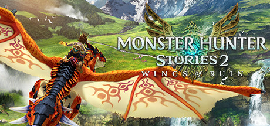

**Monster Hunter Stories 2: Wings of Ruin is the charming turn-based RPG spin-off where you raise and bond with Monsties rather than hunt them. Features a heartwarming story, deep kinship combat system, and hundreds of monster eggs to collect.**

---

## 📖 About

Monster Hunter Stories 2: Wings of Ruin is the charming turn-based RPG spin-off where you raise and bond with Monsties rather than hunt them. Features a heartwarming story, deep kinship combat system, and hundreds of monster eggs to collect.

## ⚠️ Problems Without Trainer

| Problem | Status |
|---------|--------|
| **Turn Order Dependency** — Losing the Head-to-Head rock-paper-scissors system removes offensive turns | ✅ Solved |
| **Den Farming** — Finding rare Monstie genes requires repetitive den runs with specific monsters | ✅ Solved |
| **Gene Board Complexity** — Optimizing Rite of Channeling gene boards requires deep system knowledge | ✅ Solved |
| **End-Game Boss Scaling** — Deviant and Berserk Monsties require very specific team compositions | ✅ Solved |

## ✅ Solution

The **Monster Hunter Stories 2 Trainer** solves all these issues by giving you complete control over the game.

## 🎯 Full Feature List

- Unlimited Resources
- God Mode / Invincibility
- Instant Skill Cooldown
- One-Hit Kill
- Freeze Game Timer
- Unlock All Items & Achievements
- Custom Speed Multiplier
- Save State Anywhere

## 🚀 Quick Start

1. **Disable Windows Defender** temporarily (trainer may trigger false positive)
2. Download the trainer from the button above
3. Launch Monster Hunter Stories 2
4. Run the trainer as Administrator
5. Activate desired cheats with hotkeys

## 💎 Free vs Paid

| Feature | Free | Pro |
|---------|------|-----|
| Basic God Mode | ✅ | ✅ |
| Unlimited Resources | ✅ | ✅ |
| All Advanced Cheats | ❌ | ✅ |
| Auto-Updates | ❌ | ✅ |
| Priority Support | ❌ | ✅ |

## 💻 Requirements

- Windows 10/11 (64-bit)
- Monster Hunter Stories 2 (any version)
- .NET Framework 4.8+
- DirectX 11+

## 🍎 macOS

macOS users can use our alternative tool:

## ⚖️ Legal

This trainer is for educational and single-player use only. Use responsibly.

---

